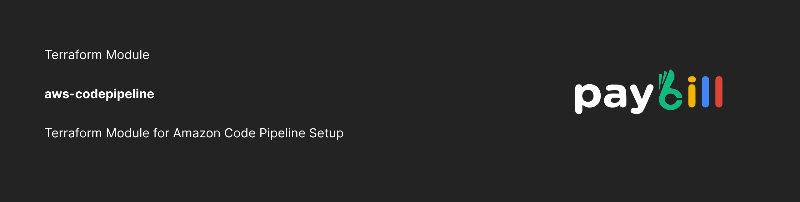

  <a href="https://paybill.dev" target="_blank">
    <picture>
      
    </picture>
  </a>

# AWS Codepipeline Terraform Module

This Terraform configuration defines a reusable **AWS CodePipeline module** that builds a CI/CD pipeline using a GitHub (or other supported) repository as the source and allows you to dynamically attach additional build/deployment stages.

### **What it does**

1. **Creates an AWS CodePipeline**

   * Name is provided via `var.name`
   * Uses an IAM role passed in via `var.role_arn`

2. **Configures Artifact Storage**

   * Stores pipeline artifacts (source code, build outputs) in an S3 bucket (`var.s3_bucket_name`)

3. **Defines a Source Stage**

   * Pulls code from a repository using **CodeStar Source Connection**
   * Connects to GitHub (or another provider using CodeStar)
   * Inputs required:

     * `source_repo_name` – e.g., `myuser/myrepo`
     * `source_repo_branch` – branch to track
     * `ConnectionArn` – CodeStar/GitHub connection ARN

4. **Creates Additional Stages Dynamically**

   * Using `dynamic "stage"` block
   * Lets you define any number of build/test/deploy stages through `var.stages`
   * Each stage supports:

     * category (e.g., Build, Deploy, Test)
     * owner
     * provider (CodeBuild, Lambda, CloudFormation, etc.)
     * input/output artifacts
     * run order
     * CodeBuild project name (via `ProjectName` in configuration)

   This means the pipeline is highly configurable without modifying module code.

5. **Outputs**

   * Exposes pipeline `id`, `name`, and `arn` after creation

<!-- BEGIN_TF_DOCS -->
## Requirements

| Name | Version |
|------|---------|
|  [terraform](#requirement\_terraform) | >= 1.3.0 |
|  [aws](#requirement\_aws) | >= 5.0.0 |

## Providers

| Name | Version |
|------|---------|
|  [aws](#provider\_aws) | >= 5.0.0 |

## Modules

No modules.

## Resources

| Name | Type |
|------|------|
| [aws_codepipeline.deployment_pipeline](https://registry.terraform.io/providers/hashicorp/aws/latest/docs/resources/codepipeline) | resource |

## Inputs

| Name | Description | Type | Default | Required |
|------|-------------|------|---------|:--------:|
|  [ConnectionArn](#input\_ConnectionArn) | Github Connection ARN | `string` | n/a | yes |
|  [name](#input\_name) | Unique name for this project | `string` | n/a | yes |
|  [role\_arn](#input\_role\_arn) | ARN of the codepipeline IAM role | `string` | n/a | yes |
|  [s3\_bucket\_name](#input\_s3\_bucket\_name) | S3 bucket name to be used for storing the artifacts | `string` | n/a | yes |
|  [source\_repo\_branch](#input\_source\_repo\_branch) | Default branch in the Source repo for which CodePipeline needs to be configured | `string` | n/a | yes |
|  [source\_repo\_name](#input\_source\_repo\_name) | Source repo name of the CodeCommit repository | `string` | n/a | yes |
|  [stages](#input\_stages) | List of Map containing information about the stages of the CodePipeline | `list(map(any))` | n/a | yes |
|  [tags](#input\_tags) | Tags to be attached to the CodePipeline | `map(any)` | n/a | yes |

## Outputs

| Name | Description |
|------|-------------|
|  [arn](#output\_arn) | The arn of the CodePipeline |
|  [id](#output\_id) | The id of the CodePipeline |
|  [name](#output\_name) | The name of the CodePipeline |
<!-- END_TF_DOCS -->